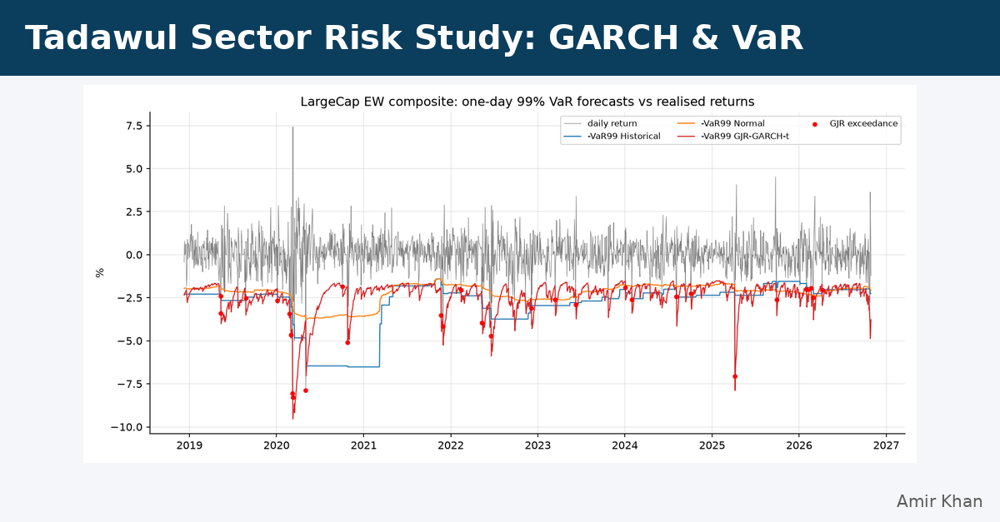
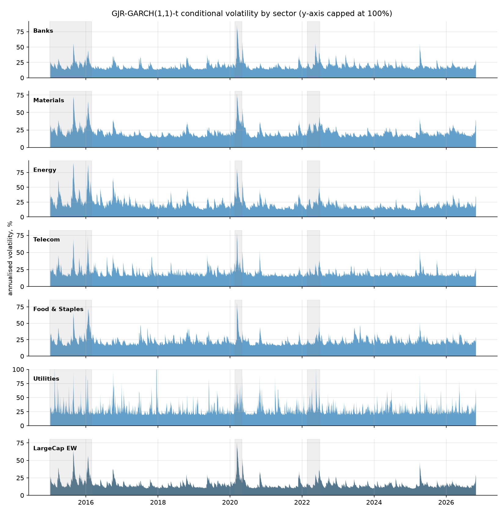
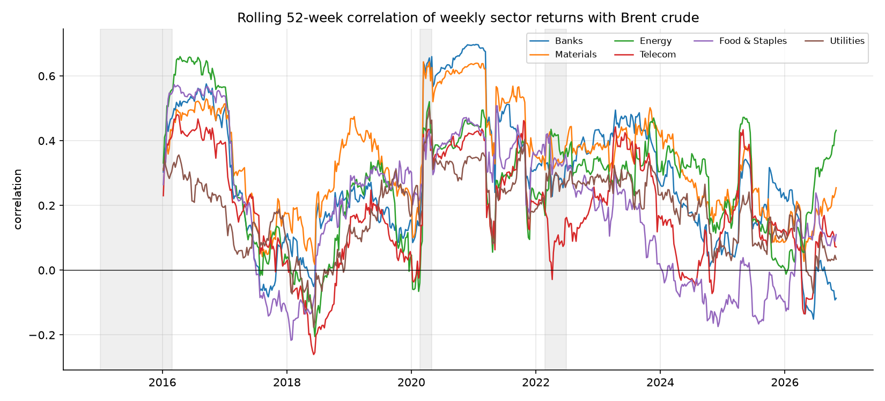
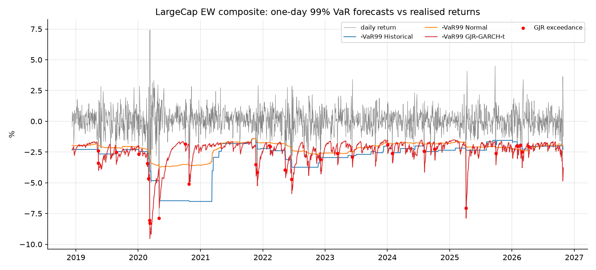
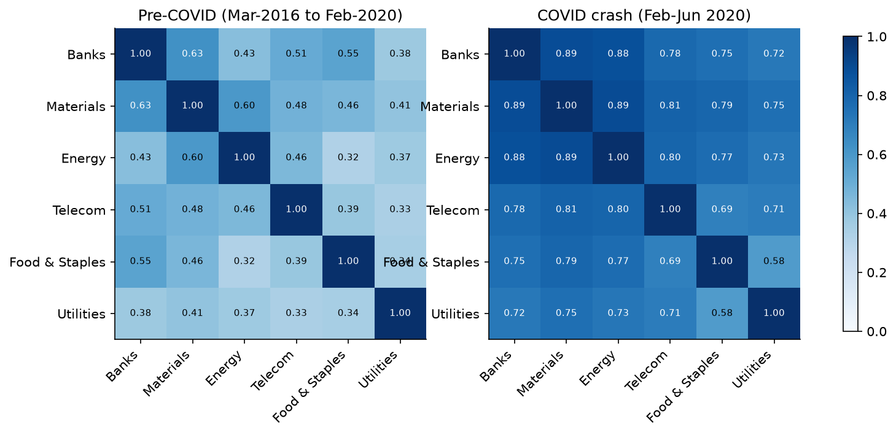

# Tadawul Sector Risk Study

> **GARCH volatility, oil-linked correlation regimes and backtested VaR/ES for six Saudi equity sectors, 2015 to 2026, on real public data with one-command reproduction.**



An independent study applying financial-engineering risk methods to the Saudi Exchange (Tadawul). It covers return statistics, GARCH(1,1) and GJR-GARCH volatility, rolling and regime correlations (including with Brent crude), drawdowns, historical and parametric VaR/ES, and out-of-sample VaR backtests using the Kupiec and Christoffersen tests.

📓 Notebook: [`notebooks/tadawul_risk_walkthrough.ipynb`](notebooks/tadawul_risk_walkthrough.ipynb)

## Headline findings (sample 2015-01-04 to 2026-10-29, 2,978 sessions)
- **Fat tails everywhere.** Excess kurtosis is 4.7 to 9.0 and every series rejects normality. The GJR leverage term γ is significant for 5 of 7 series (for the composite, γ = 0.145 vs α = 0.022).
- **COVID volatility shock.** GJR conditional volatility peaked at 76.8% for the composite on 2020-03-10, against a 13.8% median, at the same time as the OPEC+ price war.
- **Diversification fails in a crisis.** Average pairwise sector correlation rose from 0.44 (2016–19) to 0.77 (COVID crash). The weekly market–Brent correlation rose from 0.22 to 0.63, then fell to 0.19 from 2023 on.
- **Gaussian VaR fails the backtest.** 99% Normal VaR is rejected by Kupiec for 7/7 series (1.6–2.2% exceedances), rolling historical VaR for 5/7, and **GJR-GARCH-t for 0/7** (0.71–1.47%), with no significant exceedance clustering.
- **Drawdowns.** The deepest was Energy at −56.3% (2015–16). Utilities is 43.5% below its peak at the end of the sample and has not recovered.

## Working paper

**[Volatility, Correlation Regimes and Value-at-Risk in Saudi Equity Sectors, 2015–2026](reports/tadawul_sector_risk_working_paper.pdf)** (PDF). Amir Khan, Independent Researcher. Working paper, October 2026. Every number in the paper comes from the files in `reports/tables/`.

## Figures
| | |
|---|---|
|  |  |
|  |  |

Full set: `reports/figures/01–08*.png`. Tables: `reports/tables/*.csv`.

## Data (all real, public)
| Series | Source | Ticker(s) |
|---|---|---|
| 20 Tadawul large caps (split/dividend adjusted) | Yahoo Finance via `yfinance` (`auto_adjust=True`) | 1120, 1180, 1010, 1150, 1060, 2010, 1211, 2020, 2350, 2222, 2380, 4030, 2030, 7010, 7020, 7030, 2280, 2050, 5110, 2082 `.SR` |
| Brent crude (front-month futures) | Yahoo Finance | `BZ=F` |
| External benchmark | iShares MSCI Saudi Arabia ETF, Yahoo Finance | `KSA` |

The download time and ticker list are in `data/raw/MANIFEST.json`. **Official sector indices and TASI history are not available from Yahoo Finance** (`^TASI.SR` returns one row), so the **sector baskets are built** as daily-rebalanced equal-weight portfolios of each sector's large-cap constituents, and an equal-weight composite of all 20 names stands in for the market. Moves larger than Tadawul's ±10% price limit (25 stock-days in total) are treated as data or corporate-action artefacts and logged in `reports/tables/flagged_observations.csv`. Brent correlations use weekly (Thursday-anchored) returns to avoid calendar mismatch.

## Reproduce
```bash
python -m venv .venv && source .venv/bin/activate
pip install -r requirements.txt
python run.py            # single command: cached data -> tables -> figures -> thumbnail
python run.py --refresh  # re-download from Yahoo Finance first
python -m pytest -q      # 9 tests
```

## Layout
```
src/tadawul_risk/   config, data, stats, vol (GARCH/GJR), corr, risk (VaR/ES/Kupiec/Christoffersen), plots, thumbnail, pipeline
run.py              single entry point
reports/            figures/, tables/
notebooks/          executed walkthrough
tests/              unit + integration tests
data/raw/           cached prices + MANIFEST.json
```

## Methods in brief
GARCH(1,1) and GJR-GARCH(1,1,1) with Student-t errors (`arch`). Rolling 126-day correlation with the market and 52-week correlation with Brent, plus six regimes defined in advance from known events. VaR/ES at 95% and 99% (historical, Normal, Student-t). One-day-ahead backtest over 1,978 sessions: 250-day historical, 250-day Normal, and GJR-GARCH-t re-estimated every 63 days on a 1,000-day window. Tests: Kupiec POF and Christoffersen independence.

## Limitations
Equal-weight baskets of 2 to 5 large caps are proxies for the official cap-weighted sector indices. Constituents were picked from today's large caps (survivorship bias). Aramco (2019) and ACWA Power (2021) join part-way through. Yahoo Finance data may still contain errors. Models are univariate (no DCC or EVT), and there are 42 backtests with no multiple-testing correction. Regime dates are set from events, not estimated. This is descriptive risk analysis, not investment advice.

## Credits and reference repos
The design follows patterns from these open-source projects (see `/_playbooks/quant-risk-playbook.md`):
[bashtage/arch](https://github.com/bashtage/arch) (models and VaR backtest ideas) · [ranaroussi/quantstats](https://github.com/ranaroussi/quantstats) (stats/plots/report split) · [quantopian/pyfolio](https://github.com/quantopian/pyfolio) (drawdown tables, stress-period shading) · [dcajasn/Riskfolio-Lib](https://github.com/dcajasn/Riskfolio-Lib) (risk-measure taxonomy). Data courtesy of Yahoo Finance via [`yfinance`](https://github.com/ranaroussi/yfinance).

Author: **Amir Khan** · [github.com/amirator](https://github.com/amirator) · MIT License
